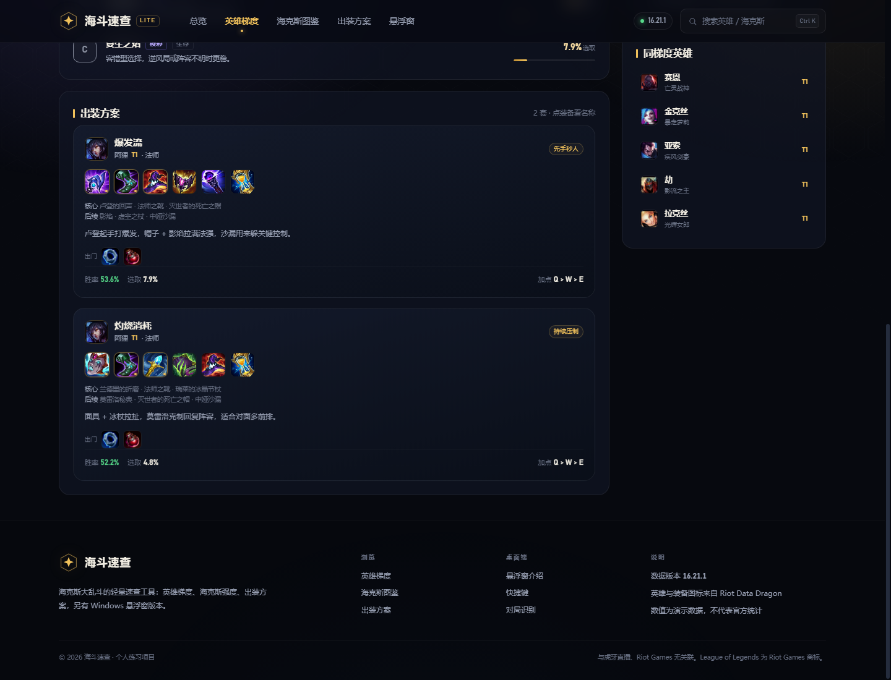
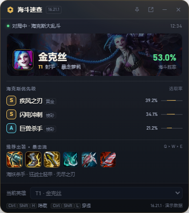

# 海斗速查 LITE

面向《英雄联盟》海克斯大乱斗（海斗）的轻量速查工具，包含**网页版**和 **Windows 桌面应用**（主窗口 + 游戏内透明悬浮窗）。

选人时看英雄梯度和胜率，进游戏后照着海克斯优先级拿强化，进商店照着出装买装备。

> 本项目为个人练习，**所有数值均为演示数据**，不代表官方或任何第三方统计。与虎牙直播、Riot Games 均无关联。


## 下载

Windows 用户可直接到 [Releases](https://github.com/kaynai1/haidou-helper/releases/latest) 下载：

- `HaidouLite-Setup-*.exe`：安装版（桌面快捷方式、开始菜单）
- `HaidouLite-*-x64.exe`：便携版（免安装，双击即用）

安装包未签名，首次运行 SmartScreen 可能提示，点“更多信息 → 仍要运行”即可。

启动后会先打开**主窗口**（完整速查界面）。悬浮窗默认隐藏，需要时按 `Ctrl Shift H` 或点系统托盘图标里的「显示悬浮窗」；进入对局后会自动弹出。网页版无需下载安装，克隆仓库后打开 `web/index.html` 即可。

## 功能

**网页版（无需安装、无构建）**

- 42 位英雄的 T1–T5 梯度、胜率、选取率与海克斯适配
- 64 个海克斯强化图鉴，按棱彩 / 黄金 / 白银分级，含适配英雄
- 84 套出装方案（每位英雄至少两套），标注核心装、出门装、技能加点
- 全局搜索（`Ctrl K`）、职业 / 梯度筛选、英雄详情、同梯度推荐
- 响应式布局，手机浏览器同样可用

**Windows 桌面应用（Electron）**

- 启动打开与网页版一致的主窗口，内置全部数据，无需浏览器
- 系统托盘常驻：打开主窗口 / 显示或隐藏悬浮窗 / 点击穿透 / 退出
- 悬浮窗透明、无边框、置顶，不占任务栏，宽度仅 384px
- 每 5 秒读取本机 Riot Live Client Data，识别到对局后自动弹出悬浮窗并切换英雄
- 悬浮窗显示 3 个海克斯强化优先级、首套推荐出装与加点
- 未进入对局或接口不可用时自动切到演示模式，可手动选择演示英雄
- 支持点击穿透，不遮挡游戏操作

| 英雄详情 | 悬浮窗（实时识别） |
| --- | --- |
|  |  |

## 快速开始

### 网页版

双击 **`启动网页版.bat`**，或直接用浏览器打开 `web/index.html`。

项目没有构建步骤、没有外部依赖，双击即用；也可以在项目根目录跑 `node tools/serve.js`，然后访问 `http://127.0.0.1:8321/`。

### 桌面应用（Windows）

推荐直接安装 Release 中的安装包，双击启动后会打开主窗口。若使用源码运行：

```bash
npm install
npm start
```

或在项目根目录双击 **`启动悬浮窗.bat`**（当前工作目录里已经内置了 Electron 运行时）。

- 从 GitHub 克隆的源码不包含 `node_modules`，需要先执行 `npm install`，或改用安装包。
- 应用未签名，首次启动 SmartScreen 可能拦截：点“更多信息 → 仍要运行”。
- 关闭主窗口后应用仍留在托盘；从托盘菜单的「退出」或 `Ctrl Shift Q` 才会完全退出。
- 悬浮窗只在**进入对局后**能识别英雄；在大厅、选人阶段会显示演示模式。

### 热键

| 热键 | 功能 |
| --- | --- |
| `Ctrl Shift H` | 显示 / 隐藏悬浮窗 |
| `Ctrl Shift L` | 点击穿透开关 |
| `Ctrl Shift R` | 重置悬浮窗位置 |
| `Ctrl Shift O` | 打开主窗口 |
| `Ctrl Shift Q` | 完全退出应用 |

点击穿透开启后，窗口不再接收鼠标事件，只能用 `Ctrl Shift L` 或热键恢复。窗口高度会随内容（如“未收录英雄”提示）自动调整。

## 构建 Windows 安装包

需要 Node 18+ 和 Windows 环境：

```bash
npm install
npm run dist
```

产物在 `dist/`：NSIS 安装包、便携版 exe 以及 `win-unpacked/` 目录。国内网络可加镜像：

```bash
npm install --registry=https://registry.npmmirror.com
```

并设置 `ELECTRON_MIRROR=https://npmmirror.com/mirrors/electron/`、`ELECTRON_BUILDER_BINARIES_MIRROR=https://npmmirror.com/mirrors/electron-builder-binaries/`。打包配置在根目录 `package.json` 的 `build` 字段，应用图标源文件为 `build/icon.svg`。

## 目录结构

```
haidou-helper/
├─ web/                        网页版（纯静态，file:// 可直接打开）
│  ├─ index.html
│  ├─ assets/css/app.css
│  ├─ assets/js/app.js
│  └─ data/data.js · data.json 生成后的数据
├─ overlay/                    Windows 桌面应用源码（Electron 33）
│  ├─ main.js                  主窗口、悬浮窗、托盘、热键、Live Client API 轮询
│  ├─ preload.js               contextBridge 暴露的 IPC 接口
│  ├─ overlay.html             悬浮窗结构与样式
│  ├─ overlay.js               悬浮窗渲染逻辑
│  └─ node_modules/            本地安装的运行时（不提交 Git）
├─ build/                      应用图标（icon.svg / icon.png）
├─ package.json                打包配置与构建脚本
├─ tools/
│  ├─ generate-data.js         演示数据生成器
│  ├─ serve.js                 本地静态服务器（开发用）
│  ├─ verify-ui.js             网页版 CDP 截图 / 交互验证
│  └─ verify-overlay.js        悬浮窗 CDP 验证
├─ documents/
│  ├─ designs/                 设计系统提取文档
│  └─ screenshots/             README 截图
├─ 启动网页版.bat
└─ 启动悬浮窗.bat
```

## 数据说明

- 数据来自演示值：梯度分组、胜率、选取率、强化评分、出装方案均在 `tools/generate-data.js` 中人工编排。
- 英雄名称、称号、装备名称与图标来自 Riot Data Dragon（16.21.1，zh_CN）。
- 悬浮窗与网页共用 `web/data/data.js`，改一处两边同步。
- 重新生成：安装 Node 18+ 后运行 `node tools/generate-data.js`。
- 想换英雄 / 强化 / 出装：编辑生成器里的 `TIERS`、`AUGMENTS`、`OVERRIDES` 等常量后重跑。

## 悬浮窗原理与隐私

- 仅访问本机 `https://127.0.0.1:2999/liveclientdata/allgamedata`，这是 Riot 客户端自带的本地接口，不向任何服务器上传数据。
- 该接口使用 Riot 本地自签名证书，`main.js` 只对这一个 127.0.0.1 请求关闭了证书校验。
- 不在对局中时接口不可达，悬浮窗回落为演示模式，不影响游戏。
- 英雄匹配同时兼容 `summonerName` / `riotId` / `riotIdGameName`，并把 `Kai'Sa`、`Kog'Maw` 等名称做归一化处理。

## 已知限制

- **数值是演示数据**，不要用于严肃上分决策。
- 当前只覆盖 42 位英雄、64 个强化，并非全英雄全强化。
- 悬浮窗仅支持 Windows；网页版支持现代浏览器（Chrome / Edge / Firefox / Safari）。
- 头像和装备图标从 Data Dragon CDN 加载，需要联网；断网时布局仍可用，图标会缺失。
- 未做代码签名和自动更新；重复启动只会聚焦已有主窗口。
- 悬浮窗与主窗口不共享滚动位置；主窗口关闭后仍驻留托盘。

## 验证记录

- 网页版：1440px 与 390px 两档宽度，搜索、筛选、强化弹窗、详情出装均通过 CDP 实测，控制台无报错（`node tools/verify-ui.js`）。
- 悬浮窗：384px 宽，演示态 / 实时识别金克丝与卡莎 / 未收录英雄提示 / 点击穿透 / 自动高度均通过（`node tools/verify-overlay.js`，需以 `--remote-debugging-port=9444` 启动）。
- 桌面应用：启动后主窗口可见、悬浮窗隐藏；`Ctrl Shift H` 显示 / 隐藏悬浮窗、托盘菜单、主窗口与悬浮窗两个页面均无控制台报错（v0.1.1 实测）。
- Windows 打包：安装包与便携版均成功生成；打包后的 `win-unpacked` 版本实测能加载内置数据、图标与自动高度，控制台无报错。
- 数据量自检：42 英雄、64 强化、84 套出装、56 件装备。

## 声明

灵感来自虎牙 LOL 海斗工具等同类产品，本项目为独立练习，与虎牙、Riot Games 无任何关联。League of Legends 及相关素材版权归 Riot Games 所有，本项目不提供任何官方数据或服务。
